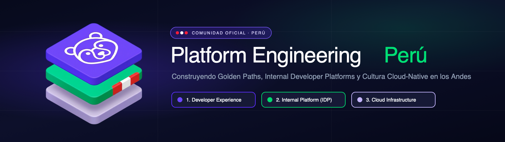

  

<h1 align="center">Great platforms. Even better people.</h1>

  A community for the people building platforms — and the people they build them for. 
  <strong>Rooted in Peru. Open to everyone.</strong>

  <a href="https://platformengineering.pe/en/">Explore the community</a> &nbsp; · &nbsp;
  <a href="https://platformengineering.pe/en/events/">Find a gathering</a> &nbsp; · &nbsp;
  <a href="https://www.linkedin.com/company/platformengineeringperu">Follow on LinkedIn</a>

---

## Better developer experiences, built together

We bring together developers, platform engineers, DevOps practitioners, SREs, and cloud specialists to exchange real experiences, learn together, and make platform engineering more approachable.

From a first golden path to an internal developer platform, we care about the same outcome: helping teams build and operate software with less friction.

| 🟣 Developer experience | 🟢 Internal developer platforms | ☁️ Cloud infrastructure |
| :--- | :--- | :--- |
| Understand developers, reduce friction, and learn what makes their work better. | Explore self-service, reusable golden paths, and platforms treated as products. | Share practical approaches to Kubernetes, automation, reliability, and operations. |

## Find your next connection

- **[Gatherings](https://platformengineering.pe/en/events/)** — Meet people, hear real stories, and exchange ideas.
- **[Resources](https://platformengineering.pe/en/resources/)** — Explore the community’s curated knowledge archive.
- **[Memories](https://platformengineering.pe/en/memories/)** — Get to know the moments and people behind the community.
- **[Community](https://platformengineering.pe/en/community/)** — Meet the organizers and find a way to take part.

## Make room for others

You do not need to be an expert to belong here. Bring a question, a lesson learned, or an idea you want to explore.

**Share your experience.** Propose a talk or help someone prepare their first one.

**Build in the open.** Explore our [community website repository](https://github.com/platform-engineering-peru/platform-engineering-web), report an issue, or suggest an improvement.

**Help make it happen.** Host a gathering, support the community, or connect us with people who would love to participate.

  <a href="https://platformengineering.pe/en/community/"><strong>Find your way in →</strong></a> &nbsp; · &nbsp;
  <a href="mailto:info@platformengineering.pe">Get in touch ↗</a>

---

  <strong>Good platforms deserve a bear hug.</strong> 
  Meet <a href="https://platformengineering.pe/en/mascot/">Ukuku</a>, our spectacled bear mascot.  
  <a href="https://platformengineering.pe/es-pe/">Conoce la comunidad en español</a> &nbsp; · &nbsp;
  <a href="https://platformengineering.pe/en/branding/">Brand assets</a>

